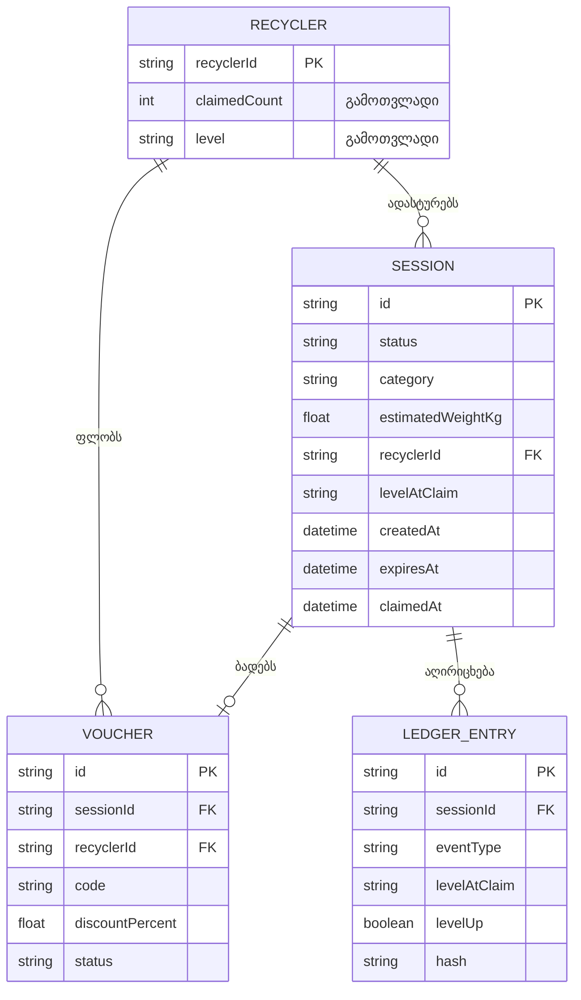
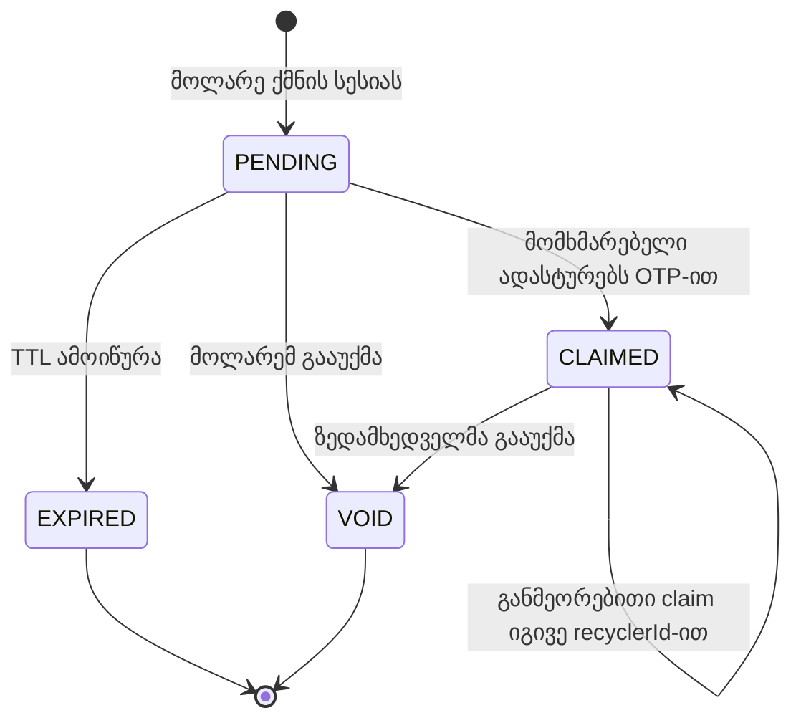

# CycleBack — ბიზნეს მოთხოვნების დოკუმენტი (BRD)

**პლატფორმა:** CycleBack — ელექტრონული ნარჩენების (e-waste) ცირკულარული ეკონომიკის პლატფორმა საქართველოსთვის (თბილისი / ბათუმი)
**პარტნიორი რეტეილერები:** Elit Electronics, Zoommer, Alta, Gstore
**დოკუმენტის ვერსია:** 1.0
**თარიღი:** 2026-10-10
**სტატუსი:** პროტოტიპის (MVP) სპეციფიკაცია — დასამტკიცებელი
**ავტორი:** Principal Enterprise Product Architect

---

## 0. დოკუმენტის მართვა და კონვენციები

### 0.1 ცვლილებების ისტორია

| ვერსია | თარიღი | აღწერა | სტატუსი |
|---|---|---|---|
| 0.1 | 2026-10-10 | პირველადი სტრუქტურა | დრაფტი |
| 1.0 | 2026-10-10 | სრული BRD: FRD, NFRD, ER/State Machine, რეგულაციური რუკა | დასამტკიცებელი |

### 0.2 კონვენციები

- **მოთხოვნის იდენტიფიკატორი:** ყველა მოთხოვნას აქვს უნიკალური ID (`A-01`, `B-03`, `C-07`, `D-05`, `N-02`), რაც უზრუნველყოფს მიკვლევადობას (traceability) ბიზნეს მიზნიდან ტესტამდე.
- **პრიორიტეტი:** `სავალდებულო` (MVP-ში აუცილებელია), `სასურველი` (MVP-ში სასურველია), `მომავალი` (პროდაქშენისთვის).
- **„დემო დაშვება“:** ყველა რიცხვი, რომელიც არ არის დადასტურებული პირველწყაროთი (კანონი, ხელშეკრულება, რეტეილერის მონაცემი), აღნიშნულია როგორც **„demo assumption"**. საკანონმდებლო ციფრები, რომლებიც არ არის გადამოწმებული პირველ წყაროზე, აღნიშნულია ფრაზით **„demo assumption — verify before production"**.
- **ტერმინოლოგია:** სტატუსებისა და დონეების კოდები (`PENDING`, `CLAIMED`, `BRONZE` და ა.შ.) ინახება ინგლისურად, რადგან ისინი ტექნიკური კონტრაქტის ნაწილია.

### 0.3 ტერმინთა ლექსიკონი

| ტერმინი | განმარტება |
|---|---|
| **WEEE** | Waste Electrical and Electronic Equipment — ელექტრო და ელექტრონული მოწყობილობების ნარჩენი |
| **EPR** | Extended Producer Responsibility — მწარმოებლის/იმპორტიორის გაფართოებული პასუხისმგებლობა |
| **OTP** | One-Time PIN — ერთჯერადი 4-ციფრიანი კოდი, რომელიც აკავშირებს მოლარის ტერმინალსა და მომხმარებლის მობილურს |
| **TTL** | Time To Live — სესიის/კოდის მოქმედების ვადა |
| **Session** | ერთი ჩაბარების აქტი (ერთი კატეგორია, ერთი სავარაუდო წონა, ერთი OTP) |
| **Recycler** | ანონიმური მომხმარებლის პროფილი, იდენტიფიცირებული `recyclerId`-ით (UUID) |
| **Drop-off** | ერთი `CLAIMED` სესია |
| **Level** | რეციკლერის დონე; **გამოთვლადი** მნიშვნელობაა და არსად ინახება დამოუკიდებლად |
| **Voucher** | მაღაზიაში მყისიერად გამოსაყენებელი ფასდაკლების ვაუჩერი |
| **Ledger** | აუდიტის დამატებადი (append-only) ჟურნალი |
| **Margin Guard** | ვაუჩერის მაქსიმალური ფასდაკლების შემზღუდველი მექანიზმი |

---

## 1. აღმასრულებელი რეზიუმე და ღირებულების შეთავაზება

### 1.1 პრობლემა

საქართველოში იმპორტიორები „ნარჩენების მართვის კოდექსის“ ფარგლებში WEEE-ზე მწარმოებლის გაფართოებული პასუხისმგებლობის (EPR) სამიზნე მაჩვენებლების წინაშე დგანან და ვალდებულების შეუსრულებლობა სანქციებს უკავშირდება. სამიზნე მაჩვენებლის შესასრულებლად საჭიროა ნარჩენის შეგროვება მომხმარებლებისგან, თუმცა **სამომხმარებლო შეგროვების ინფრასტრუქტურა პრაქტიკულად არ არსებობს**: მომხმარებელმა არ იცის სად და რატომ დააბრუნოს ძველი ტექნიკა, ხოლო იმპორტიორს არ აქვს აუდიტირებადი მონაცემი ჩაბარებული მასის შესახებ.

### 1.2 გადაწყვეტა: Zero-Capex მოდელი

CycleBack **არ აწარმოებს ურნებს და არ აშენებს ინფრასტრუქტურას**. შეგროვების წერტილად გამოიყენება პარტნიორი რეტეილერის არსებული სალარო მაგიდა. მოლარე რეგისტრირებს ჩაბარებულ ნივთს ვებ-ტერმინალზე, მომხმარებელი კი მობილურით ადასტურებს ჩაბარებას 4-ციფრიანი OTP-ით.

### 1.3 სამმაგი ღირებულების ციკლი

**ძრავა 1 — იურიდიული EPR შესაბამისობა.** ყოველი დადასტურებული ჩაბარება ქმნის აუდიტირებად ჩანაწერს (კატეგორია, წონა, დრო, მაღაზია), რომელიც აგრეგირდება B2B დაშბორდზე და გამოიყენება სამინისტროსთვის ანგარიშგებაში (გარემოს დაცვისა და სოფლის მეურნეობის სამინისტრო).

**ძრავა 2 — მაღაზიაში ტრაფიკის კონვერსია.** ჩაბარების დადასტურება მყისიერად ხსნის მინი-თამაშს (Fortune Wheel), რომლის შედეგია ფასდაკლების ვაუჩერი. მომხმარებელი ფიზიკურად მაღაზიაშია, ამიტომ მყისიერი წახალისება ზრდის ადგილზე შესყიდვის ალბათობას.

**ძრავა 3 — ლოიალობის ციკლი (დონეები).** რეციკლერის დონე გამოითვლება დადასტურებული ჩაბარებების რაოდენობით. მაღალი დონე = უკეთესი Wheel-ის პრიზების ცხრილი. ეს ქმნის მიზეზს, რომ მომხმარებელმა **განმეორებით** დააბრუნოს ტექნიკა, რაც ზრდის შეგროვებულ მასას და რეტეილერისთვის განმეორებით ვიზიტებს.

```text
 მომხმარებელი ჩააბარებს → OTP დადასტურება → CLAIMED
        │                                        │
        ├─► EPR ჩანაწერი (Ledger) ─► Dashboard ─► სამინისტროს ანგარიში
        ├─► Level-ის გადათვლა ─► Level-up ანიმაცია
        └─► Level-ზე მორგებული Wheel ─► ვაუჩერი ─► ადგილზე შესყიდვა
                                                       │
                              განმეორებითი ვიზიტი ◄─────┘
```

### 1.4 ბიზნეს მოდელი (მხოლოდ BRD; აპლიკაციის ლოგიკაზე გავლენის გარეშე)

- ვაუჩერის ფასდაკლებას **აფინანსებს პარტნიორი რეტეილერი**.
- CycleBack იღებს **ფასდაკლების თანხის წილს** (demo assumption: **20%**) მხოლოდ მაშინ, როცა მომხმარებელი **რეალურად ყიდულობს** და ვაუჩერი გამოყენებულია (`REDEEMED`).
- ვაუჩერის გამოუყენებლობის შემთხვევაში CycleBack-ს შემოსავალი არ აქვს, რეტეილერს კი ხარჯი.

**საილუსტრაციო გათვლა (demo assumption):**

| პარამეტრი | მნიშვნელობა |
|---|---|
| შესყიდვის თანხა | 1 000 ₾ |
| ვაუჩერის ფასდაკლება | 5% = 50 ₾ |
| რეტეილერის ხარჯი | 50 ₾ (ფასდაკლება) |
| CycleBack-ის წილი (20%) | 10 ₾ |
| რეტეილერის სარგებელი | გაყიდვა 950 ₾ + EPR შესაბამისობა შეგროვებული მასით |

### 1.5 წარმატების მაჩვენებლები (KPI) — ყველა სამიზნე demo assumption

| KPI | განმარტება | სამიზნე (demo assumption) |
|---|---|---|
| ჩაბარების დადასტურების მაჩვენებელი | `CLAIMED` / (`CLAIMED` + `EXPIRED`) | ≥ 85% |
| ვაუჩერის გამოყენების (კონვერსიის) მაჩვენებელი | `REDEEMED` / `ISSUED` | ≥ 25% |
| განმეორებითი რეციკლერების წილი | რეციკლერები ≥ 2 `CLAIMED`-ით / რეციკლერები ≥ 1 `CLAIMED`-ით | ≥ 30% |
| საშუალო ჩაბარება რეციკლერზე | `CLAIMED` სესიები / უნიკალური რეციკლერი | ≥ 1.8 |
| რეგისტრაციის დრო მოლარესთან | კატეგორიის არჩევიდან OTP-ის ჩვენებამდე | ≤ 15 წმ |

### 1.6 მასშტაბის გარეთ (Out of Scope — პროტოტიპი)

- რეალური მომხმარებლის ავთენტიფიკაცია (ტელეფონის ნომრით) — იხ. 2.3 და 7.4.
- მოლარეებისა და ზედამხედველების ავთენტიფიკაცია/როლები (პროტოტიპში ტერმინალი ღიაა).
- პერსისტენტული მონაცემთა ბაზა (პროტოტიპში მეხსიერებაა; სერვერის გადატვირთვა ასუფთავებს მონაცემს).
- ნარჩენის ტრანსპორტირება და ლიცენზირებულ გადამამუშავებლამდე მიტანის ჯაჭვი (chain of custody).
- ვაუჩერის რეალური გამოყენება POS სისტემაში (პროტოტიპი ვაუჩერს გასცემს; გამოყენების ინტეგრაცია პროდაქშენის ეტაპია).

---

## 2. დაინტერესებული მხარეები და პერსონები

### 2.1 პერსონა 1: მაღაზიის მოლარე (Store Clerk / Cashier)

| ველი | აღწერა |
|---|---|
| **სახელი / როლი** | ნინო, მოლარე-კონსულტანტი, ორ-სამ მომხმარებელს ემსახურება ერთდროულად |
| **მიზანი** | ჩაბარების სწრაფი რეგისტრაცია, რიგის გაუჭიანურებლად |
| **ტკივილი** | დამატებითი ქაღალდი ან რთული ინტერფეისი; ფიქრი, თუ რომელი კატეგორიაა სწორი |
| **საჭიროება** | კლავიატურაზე ორიენტირებული ფორმა; OTP მკაფიოდ და დიდად; დადასტურების მყისიერი სიგნალი |
| **წარმატების კრიტერიუმი** | რეგისტრაცია ≤ 15 წმ-ში; შეცდომის შემთხვევაში სესიის მარტივი გაუქმება |

### 2.2 პერსონა 2: რეტეილერის ESG / Compliance ოფიცერი

| ველი | აღწერა |
|---|---|
| **სახელი / როლი** | გიორგი, ESG და შესაბამისობის მენეჯერი ქსელის ცენტრალურ ოფისში |
| **მიზანი** | EPR სამიზნეების შესრულების დემონსტრირება სამინისტროს წინაშე; სანქციების რისკის შემცირება |
| **ტკივილი** | ხელით შეგროვებული, არაგადამოწმებადი მონაცემი; ფილიალებს შორის შეუსაბამობა |
| **საჭიროება** | რეალურ დროში პროგრესი სამიზნესთან; კატეგორიებისა და წონის დეტალიზაცია; CSV/PDF ექსპორტი; აუდიტის ჟურნალი |
| **წარმატების კრიტერიუმი** | ანგარიშის მომზადება წუთებში, ყოველი ციფრის წყაროს მოძიებით |

### 2.3 პერსონა 3: მომხმარებელი / რეციკლერი (Consumer / Recycler)

**3ა. პირველად მომსვლელი**

| ველი | აღწერა |
|---|---|
| **სახელი / როლი** | ლევანი, 28 წლის, ძველ ლეპტოპს აბრუნებს პირველად |
| **მიზანი** | ძველი ნივთისგან მარტივად თავის დაღწევა და მცირე სარგებლის მიღება |
| **ტკივილი** | რეგისტრაცია, აპლიკაციის ჩამოტვირთვა, პირადი მონაცემების მოთხოვნა |
| **საჭიროება** | რეგისტრაციის გარეშე, ბრაუზერიდან, 10 წამში; მყისიერი სიამოვნება (თამაში, ვაუჩერი) |

**3ბ. დაბრუნებული, დონეგაზრდილი რეციკლერი**

| ველი | აღწერა |
|---|---|
| **სახელი / როლი** | მარიამი, მე-5 ჩაბარებისას აღწევს GOLD დონეს |
| **მოტივაცია** | პროგრესის ხილვადობა, დონის სტატუსი, უკეთესი პრიზები |
| **საჭიროება** | პროგრესის ზოლი („3 / 5 — GOLD-მდე“); დონის ამაღლების ემოციური მომენტი; დონესთან მიბმული უკეთესი Wheel |
| **რისკი** | თუ დონე „დაიკარგა“ ტექნიკური ხარვეზით, ნდობა იკარგება → დონე ყოველთვის გამოითვლება `CLAIMED` სესიებიდან |

> **პროტოტიპის გამარტივება:** რეციკლერი ანონიმურია და იდენტიფიცირებულია ბრაუზერში შენახული `recyclerId` (UUID v4) მეშვეობით (localStorage + cookie). ბრაუზერის მონაცემების გასუფთავება ან მოწყობილობის შეცვლა იწვევს პროგრესის დაკარგვას. **პროდაქშენში** მომხმარებელი უნდა იდენტიფიცირდეს **დადასტურებული ტელეფონის ნომრით** (SMS OTP), რაც უზრუნველყოფს პროგრესის გადატანას მოწყობილობებს შორის და საფუძველს იძლევა თაღლითობის კონტროლისთვის.

### 2.4 დამატებითი დაინტერესებული მხარეები

| მხარე | ინტერესი |
|---|---|
| გარემოს დაცვისა და სოფლის მეურნეობის სამინისტრო | სანდო, აგრეგირებული EPR მონაცემი |
| CycleBack-ის ოპერაციული გუნდი | სისტემის სტაბილურობა, თაღლითობის მონიტორინგი |
| ლიცენზირებული გადამამუშავებელი (მომავალი ფაზა) | შემოსული მასის შედარება რეგისტრირებულ მასასთან |

---

## 3. ფუნქციური სპეციფიკაცია (FRD)

### Module A: POS მიღება და OTP-ის სასიცოცხლო ციკლი

**მიზანი:** მოლარემ ჩაბარება დაარეგისტრიროს სწრაფად, ხოლო OTP იყოს უსაფრთხო, უნიკალური და დროში შეზღუდული.

#### A.1 შემავალი მონაცემები

| ველი | წესი |
|---|---|
| **კატეგორია** | ერთ-ერთი: `LAPTOP`, `PHONE`, `MONITOR`, `CABLE`, `BATTERY` |
| **სავარაუდო წონა (კგ)** | დადებითი რიცხვი ზუსტობით 0.01 კგ; დასაშვები დიაპაზონი კატეგორიის მიხედვით (იხ. A.4) |
| **მაღაზია** | `storeId` და რეტეილერი (პროტოტიპში ერთ-ერთი ოთხი პარტნიორიდან, ტერმინალზე არჩეული) |

#### A.2 მოთხოვნები

| ID | მოთხოვნა | პრიორიტეტი | მიღების კრიტერიუმი |
|---|---|---|---|
| A-01 | ტერმინალი კლავიატურაზე ორიენტირებულია: კატეგორია იცვლება ციფრებით 1–5, წონა შეიყვანება პირდაპირ, `Enter` ქმნის სესიას | სავალდებულო | მოლარე სესიას ქმნის თაგვის გარეშე |
| A-02 | OTP არის **ზუსტად 4 ციფრი** (`0000`–`9999`, წინა ნულებით), გენერირებული კრიპტოგრაფიულად უსაფრთხო წყაროთი (CSPRNG). `Math.random` აკრძალულია | სავალდებულო | კოდის მიმოხილვა და სტატისტიკური ტესტი: თანაბარი განაწილება 10 000 გენერაციაზე |
| A-03 | OTP-ის TTL: **300 წამი** (5 წუთი, demo assumption) სესიის შექმნიდან. ტერმინალზე ჩანს უკუთვლა | სავალდებულო | 301-ე წამზე სესია `EXPIRED`-ია, claim აბრუნებს 410-ს |
| A-04 | ვადის გასვლა მოწმდება ორი გზით: (1) ყოველ წაკითხვაზე/claim-ზე (lazy expiry), (2) პერიოდული გასუფთავებით. სტატუსი არასდროს „გაიყინება“ `PENDING`-ზე | სავალდებულო | სესია, რომელზეც არავინ მიმართავს, მაინც ხდება `EXPIRED` |
| A-05 | **უნიკალურობა:** ახალი OTP არ ემთხვევა არცერთ `PENDING` სესიას და არცერთ კოდს, რომელიც ბოლო 10 წუთში გავიდა `PENDING` მდგომარეობიდან (კარანტინი). კარანტინი იცავს იმისგან, რომ ვადაგასული კოდის გვიან შემომყვანმა სხვის ახალ სესიაზე მოახდინოს claim | სავალდებულო | 1 000 თანმიმდევრული გენერაციისას დუბლიკატი აქტიურ ან კარანტინის კოდებში არ ჩნდება |
| A-06 | **კოლიზიის მართვა:** გენერაცია იმეორებს ცდას მაქსიმუმ 50-ჯერ. თუ თავისუფალი კოდი ვერ მოიძებნა (სივრცე ამოწურულია), სისტემა აბრუნებს „სერვისი დროებით დატვირთულია“ (503) და არ ქმნის სესიას | სავალდებულო | სივრცის ხელოვნურად შევსებისას სისტემა არ ჩერდება და არ ქმნის დუბლიკატს |
| A-07 | **Rate limiting (ტერმინალზე):** მაქსიმუმ **10 სესია წუთში** ერთ ტერმინალზე; მაქსიმუმ **50 ერთდროული `PENDING`** ერთ მაღაზიაში (demo assumption). გადაჭარბებისას — 429 | სავალდებულო | მე-11 მოთხოვნა წუთში უარყოფილია |
| A-08 | მოლარეს შეუძლია `PENDING` სესიის გაუქმება (`VOID`) შეცდომის შემთხვევაში. `CLAIMED` სესიის გაუქმება შეუძლია მხოლოდ ზედამხედველს **24 საათის განმავლობაში** და ობლიგატორული მიზეზის კოდით (პროტოტიპში მოქმედება ხელმისაწვდომია დემო რეჟიმში) | სავალდებულო | გაუქმებული სესია აღარ ითვლება დონეში (იხ. 5.4) |
| A-09 | ტერმინალი სესიის სტატუსს ამოწმებს პერიოდული polling-ით ყოველ **2 წამში**, ხოლო სერვერი რჩება სწრაფი (N-02) | სავალდებულო | `CLAIMED` სტატუსი ტერმინალზე ჩანს ≤ 3 წმ-ში |
| A-10 | როცა სესია ხდება `CLAIMED`, ტერმინალი აჩვენებს დადასტურებას. თუ claim-მა გამოიწვია **დონის ამაღლება**, ჩნდება მცირე ინდიკატორი „ახალი დონე მიღწეულია“ და დონის სახელი. რეციკლერის იდენტობა ტერმინალზე **არ ჩანს** | სავალდებულო | level-up claim-ზე ინდიკატორი ჩანს; ჩვეულებრივ claim-ზე არა |
| A-11 | ყოველი სესიის შექმნა ჩაიწერება: დრო, `storeId`, ტერმინალის/მოლარის იდენტიფიკატორი, კატეგორია, წონა | სავალდებულო | ჩანაწერი ხელმისაწვდომია აუდიტის ცხრილში |

#### A.3 OTP-ის უსაფრთხოების ანალიზი (ბრუტფორსის რისკი)

4-ციფრიან სივრცეში (10 000 კომბინაცია) ერთი შემთხვევითი ცდის წარმატების ალბათობა უდრის აქტიური `PENDING` კოდების რაოდენობას გაყოფილს 10 000-ზე. მაგალითად, 20 აქტიური კოდის დროს ერთი შემთხვევითი ცდა 0.2%-ია, ხოლო 5 ცდა დაახლოებით 1%. ეს არის **ცნობილი ნარჩენი რისკი**: შემთხვევითმა შემომყვანმა შეიძლება სხვის სესიაზე გააკეთოს claim. შემარბილებელი ზომები (ყველა ერთად):

1. მცდელობების ლიმიტი (B-03) და დროებითი დაბლოკვა.
2. მოკლე TTL (A-03) აქტიური კოდების რაოდენობის შესამცირებლად.
3. არასწორი კოდების აუდიტი და ანომალიის დროშა დაშბორდზე (B-08).
4. არასავალდებულო გეოფენსი (B-04), რომელიც მოითხოვს მომხმარებლის ფიზიკურ ყოფნას მაღაზიაში.
5. პროდაქშენში: მაღაზიის კოდის (`storeId`) მიბმა ან 6-ციფრიან OTP-ზე გადასვლა (იხ. 7.4).

#### A.4 კატეგორიების წონითი ზღვრები (demo assumption)

| კატეგორია | ნაგულისხმევი წონა (კგ) | მინიმუმი (კგ) | მაქსიმუმი (კგ) |
|---|---|---|---|
| `LAPTOP` | 2.0 | 0.5 | 5.0 |
| `PHONE` | 0.2 | 0.05 | 0.5 |
| `MONITOR` | 5.0 | 1.0 | 15.0 |
| `CABLE` | 0.5 | 0.05 | 3.0 |
| `BATTERY` | 0.5 | 0.02 | 5.0 |

ზღვრებს გარეთ მყოფი წონა მოლარეს უბრუნდება შეცდომით (400) და არ ქმნის სესიას.

---

### Module B: მომხმარებლის ვერიფიკაცია და თაღლითობისგან დაცვა

**მიზანი:** მომხმარებელმა მარტივად დაადასტუროს ჩაბარება, ხოლო სისტემამ ხელი შეუშალოს გაყალბებას და დონეებით მანიპულირებას.

#### B.1 მოთხოვნები

| ID | მოთხოვნა | პრიორიტეტი | მიღების კრიტერიუმი |
|---|---|---|---|
| B-01 | **recyclerId-ის ინიციალიზაცია:** `/verify`-ზე პირველი ვიზიტისას გენერირდება UUID v4 და ინახება localStorage-ში და cookie-ში. შემდგომ ვიზიტებზე გამოიყენება იგივე; თუ ერთი წყარო არ არის, მეორე აღადგენს | სავალდებულო | გვერდის გადატვირთვის შემდეგ `recyclerId` უცვლელია |
| B-02 | **4-ციფრიანი შეყვანა:** ავტომატური გადასვლა შემდეგ უჯრაზე, backspace-ით უკან, ჩასმის (paste) მხარდაჭერა, რიცხვითი კლავიატურა მობილურზე | სავალდებულო | 4 ციფრის შეყვანა ≤ 3 წმ-ში; ბოლო ციფრზე ავტომატური გაგზავნა |
| B-03 | **მცდელობების ლიმიტი:** მაქსიმუმ **5 არასწორი კოდი 5 წუთში** ერთ `recyclerId`-ზე, შემდეგ **5-წუთიანი** დაბლოკვა (429). დამატებით IP-ზე: მაქსიმუმ 20 არასწორი ცდა 10 წუთში (demo assumption) | სავალდებულო | მე-6 არასწორი ცდა უარყოფილია 429-ით |
| B-04 | **გეოფენსი (არასავალდებულო გადამრთველი):** როცა ჩართულია, claim მოითხოვს მომხმარებლის კოორდინატებს. თუ მოწყობილობა მაღაზიიდან **150 მ-ზე** მეტ მანძილზეა ან სიზუსტე უარესია 100 მ-ზე, claim უარყოფილია (403). **პროტოტიპში ნაგულისხმევად გამორთულია** (ლოკალური ქსელი და დემო გარემო), პროდაქშენში ჩართულია | სასურველი | ჩართვისას მაღაზიიდან შორს მყოფი მოწყობილობა ვერ ადასტურებს |
| B-05 | **სესიის ინვალიდაცია:** `PENDING` სესია შეიძლება გახდეს `VOID` მოლარის მიერ; `CLAIMED` — ზედამხედველის მიერ (A-08). `VOID` სესიაზე claim აბრუნებს 410-ს | სავალდებულო | იხ. 5.4 |
| B-06 | **ერთი სესია — ერთი რეციკლერი:** სესია, რომელიც უკვე `CLAIMED`-ია სხვა `recyclerId`-ით, აბრუნებს 409-ს. იგივე `recyclerId`-ის განმეორებითი მოთხოვნა არის **იდემპოტენტური** (B-07) | სავალდებულო | სხვა recycler-ით მეორე claim უარყოფილია |
| B-07 | **იდემპოტენტობა / ორმაგი გაგზავნის დაცვა:** claim ატომურია. ორმაგი დაწკაპუნება, ქსელური retry ან პარალელური მოთხოვნა **ვერასდროს გაზრდის drop-off-ების რაოდენობას ერთზე მეტად**. განმეორებითი მოთხოვნა იგივე `recyclerId`-ით აბრუნებს **იმავე შედეგს** (იგივე ვაუჩერი, იგივე Wheel-ის შედეგი) მარკერით „უკვე დადასტურებულია“ და არ ქმნის დამატებით ჩანაწერს | სავალდებულო | 10 პარალელური claim ერთ სესიაზე → count +1, ერთი ვაუჩერი |
| B-08 | **ანომალიების დროშები:** სისტემა აღნიშნავს (დაშბორდზე) რეციკლერებს, რომლებიც აჭარბებენ დღიურ ლიმიტს ან აქვთ 10 წუთზე ნაკლები ინტერვალი ჩაბარებებს შორის სხვადასხვა მაღაზიაში; ასევე მაღაზიებს ექსტრემალურად მაღალი წონით ან `VOID`-ების წილით | სასურველი | ანომალიური მონაცემი ჩანს „საეჭვო“ მარკერით |
| B-09 | **დღიური ლიმიტი (დონეებით მანიპულირების წინააღმდეგ):** მაქსიმუმ N დადასტურებული ჩაბარება დღეში ერთ `recyclerId`-ზე. **პროტოტიპში გამორთულია** (დემო სცენარი მოითხოვს თანმიმდევრულ ჩაბარებებს), პროდაქშენის რეკომენდაცია: **3 დღეში** (demo assumption) | სასურველი | ჩართვისას მე-4 claim უარყოფილია |
| B-10 | პერსონალური მონაცემები არ გროვდება. `recyclerId` ხელოვნური იდენტიფიკატორია და არ შეიცავს ინფორმაციას პირის შესახებ | სავალდებულო | ლოგებსა და ჟურნალში არ ფიქსირდება სახელი, ტელეფონი, ელფოსტა |

#### B.2 claim-ის შედეგები (HTTP სემანტიკა, მაღალი დონე)

| სიტუაცია | შედეგი |
|---|---|
| წარმატებული claim | 200: ვაუჩერი, განახლებული პროგრესი, `levelUp` (საჭიროებისას) |
| განმეორებითი claim იგივე `recyclerId`-ით | 200: იგივე შედეგი, `alreadyClaimed` მარკერით |
| არასწორი ფორმატი (არა 4 ციფრი, ცარიელი `recyclerId`) | 400 |
| გეოფენსი ჩართულია და მოწყობილობა ზონის გარეთაა | 403 |
| კოდი არ არსებობს | 404 |
| სესია უკვე დადასტურებულია სხვა რეციკლერის მიერ | 409 |
| სესია ვადაგასულია ან გაუქმებულია | 410 |
| მცდელობების ლიმიტი | 429 |
| შიდა შეცდომა | 500 |

---

### Module C: გეიმიფიკაცია, დონეები და ჯილდოების ძრავა

**მიზანი:** ჩაბარების შემდეგ მყისიერად გადაიქცეს მომხმარებელი მყიდველად, ხოლო დონეებმა უზრუნველყონ განმეორებითი ჩაბარება.

#### C.1 დონეები და ზღურბლები (ერთადერთი სიმართლის წყარო)

დონე **გამოითვლება და არ ინახება დამოუკიდებლად**: დონე = ყველაზე მაღალი დონე, რომლის ზღურბლი ≤ ამ რეციკლერის `CLAIMED` სესიების რაოდენობას. `EXPIRED` და `VOID` სესიები არასდროს ითვლება.

| დონე | კოდი | ზღურბლი (drop-off) | მომდევნომდე დარჩენილი |
|---|---|---|---|
| ურანგო | `UNRANKED` | 0 | 1 |
| ბრინჯაო | `BRONZE` | 1 | 2 |
| ვერცხლი | `SILVER` | 3 | 2 |
| ოქრო | `GOLD` | 5 | 3 |
| პლატინა | `PLATINUM` | 8 | 4 |
| ბრილიანტი | `DIAMOND` | 12 | — (მაქსიმუმი) |

ზღურბლები **ერთ ტიპიზებულ კონსტანტაშია** (`LEVEL_CONFIG`), რათა ადვილად შეიცვალოს ბიზნეს გადაწყვეტილებით. ყველა ზღურბლი demo assumption-ია.

#### C.2 მოთხოვნები

| ID | მოთხოვნა | პრიორიტეტი | მიღების კრიტერიუმი |
|---|---|---|---|
| C-01 | ყოველი წარმატებული claim მყისიერად ზრდის რეციკლერის `CLAIMED` რაოდენობას ერთით და ახდენს დონის გადათვლას | სავალდებულო | 1-ლი claim → `BRONZE` |
| C-02 | **Level-up:** თუ claim-მა გადაკვეთა ზღურბლი, პასუხი შეიცავს `levelUp` ობიექტს (`from`, `to`). მისი არარსებობა ნიშნავს, რომ დონე არ შეცვლილა | სავალდებულო | მე-2-დან მე-3 ჩაბარებაზე გადასვლისას `levelUp = { from: BRONZE, to: SILVER }` |
| C-03 | **Level-up ანიმაცია `/verify`-ზე:** ბეჯის გამოვლენა (badge reveal), ახალი დონის სახელი, პროგრესი შემდეგ დონემდე. ანიმაცია 2–3 წამია, გამოტოვებადია და პატივს სცემს მოწყობილობის „შემცირებული მოძრაობის“ პარამეტრს (`prefers-reduced-motion`) | სავალდებულო | ანიმაცია ჩანს მხოლოდ level-up-ზე |
| C-04 | **პროგრესის ზოლი:** ტექსტი „X / Y drop-off — NEXT_LEVEL-მდე“, სადაც **X = მიმდინარე `CLAIMED` რაოდენობა**, **Y = შემდეგი დონის ზღურბლი**. ზოლის შევსება = (X − მიმდინარე დონის ზღურბლი) / (Y − მიმდინარე დონის ზღურბლი). ზოლი ჩანს თამაშამდე და მის შემდეგ. `DIAMOND`-ზე ნაჩვენებია „მაქსიმალური დონე“ | სავალდებულო | მაგ.: 2 drop-off, დონე `BRONZE` → „2 / 3 — SILVER-მდე“, ზოლი 50% |
| C-05 | **Fortune Wheel ხელმისაწვდომია მხოლოდ `CLAIMED`-ის შემდეგ** და ერთხელ თითო სესიაზე. თამაშის შედეგი **სერვერზე** წყდება claim-ის მომენტში და ინახება ვაუჩერში. კლიენტი მხოლოდ ანიმაციას ასრულებს მიღებულ შედეგამდე | სავალდებულო | გვერდის გადატვირთვა ან განმეორებითი claim ვერ ცვლის შედეგს |
| C-06 | **Wheel-ის დონე:** პრიზების ცხრილის არჩევისას გამოიყენება დონე **claim-ის შემდეგ** (ანუ ახლადმიღწეული დონე, თუ level-up მოხდა) | სავალდებულო | `SILVER`-ზე ახლად აღმავალი რეციკლერი იღებს `SILVER`-ის ცხრილს |
| C-07 | შემთხვევითობა: Wheel-ის წონითი არჩევა იყენებს CSPRNG-ს; ნაჭრების წონათა ჯამი ყველა დონეზე = 100 | სავალდებულო | სტარტაპ-ვალიდაცია ამოწმებს ჯამს |
| C-08 | **ვაუჩერის ბილეთი:** მაღალკონტრასტიანი ვიზუალი: ფასდაკლების %, უნიკალური კოდი, მაღაზია/რეტეილერი, მოქმედების ვადა, მინიმალური შესყიდვა, ეკრანის სურათისთვის მოხერხებული | სავალდებულო | ვაუჩერი იკითხება მზის სინათლეზე (WCAG AA კონტრასტი) |
| C-09 | **`VOID`-ის ეფექტი:** `CLAIMED` სესიის გაუქმებისას რაოდენობა და დონე გადაითვლება, გამოუყენებელი ვაუჩერი გაუქმდება (`REVOKED`), **დაქვეითების ანიმაცია არ ჩნდება** — პროგრესი უბრალოდ განახლდება | სავალდებულო | გაუქმების შემდეგ API პასუხი ახალ დონეს აბრუნებს |
| C-10 | შეუძლებელია ორი ვაუჩერის გაცემა ერთი სესიისთვის | სავალდებულო | იხ. B-07 |

#### C.3 Fortune Wheel-ის პრიზების ცხრილები (demo assumption)

თითოეული ცხრილი შედგება წონიანი სეგმენტებისგან (ფასდაკლების პროცენტი : წონა). **ყველა სეგმენტი არის ჯილდო** (ცარიელი სეგმენტი არ არსებობს), რადგან მიზანია კონვერსია და არა იმედგაცრუება. წონათა ჯამი ყოველ ცხრილში = 100.

| დონე | სეგმენტები (ფასდაკლება % : წონა) | მაქსიმუმი | მოსალოდნელი საშუალო ფასდაკლება |
|---|---|---|---|
| `UNRANKED` * | 2% : 70, 3% : 30 | 3% | 2.3% |
| `BRONZE` | 2% : 50, 3% : 30, 5% : 20 | 5% | 2.9% |
| `SILVER` | 2% : 30, 3% : 30, 5% : 25, 7% : 15 | 7% | 3.8% |
| `GOLD` | 3% : 25, 5% : 30, 7% : 25, 10% : 20 | 10% | 6.0% |
| `PLATINUM` | 5% : 25, 7% : 30, 10% : 30, 12% : 15 | 12% | 8.15% |
| `DIAMOND` | 5% : 15, 7% : 25, 10% : 30, 12% : 20, 15% : 10 | 15% | 9.4% |

\* `UNRANKED` ცხრილი არსებობს სისტემური სისრულისთვის. წარმატებული claim-ის შემდეგ რეციკლერი მინიმუმ `BRONZE`-ია, ამიტომ ეს ცხრილი ნორმალურ ნაკადში არ გამოიყენება.

#### C.4 ვაუჩერის წესები (demo assumption)

| პარამეტრი | მნიშვნელობა |
|---|---|
| ფორმატი | უნიკალური კოდი `CB-XXXX-XXXX` (ორაზროვანი სიმბოლოების გარეშე: `0/O`, `1/I`) |
| მოქმედების ვადა | 24 საათი გაცემიდან |
| გამოყენების ადგილი | მხოლოდ გამცემ რეტეილერში |
| მინიმალური შესყიდვა | 100 ₾ |
| გაერთიანება სხვა აქციებთან | დაუშვებელია |
| ერთჯერადობა | ერთი ვაუჩერი — ერთი გამოყენება |
| სტატუსები | `ISSUED`, `REDEEMED`, `EXPIRED`, `REVOKED` |

#### C.5 ვაუჩერის მარჟის დაცვა (Margin Guards) — demo assumption

რეტეილერის მარჟის დასაცავად მოქმედებს ხუთი დამოუკიდებელი შეზღუდვა:

| ID | დაცვა | წესი |
|---|---|---|
| G1 | გლობალური ზედა ზღვარი | ფასდაკლება არასდროს აღემატება **15%-ს** |
| G2 | დონის ზღვარი | გაცემული % ≤ დონისთვის განსაზღვრულ მაქსიმუმს (C.3), **მაშინაც კი, თუ ცხრილი შეცდომით არასწორადაა კონფიგურირებული** (min-ლოგიკა) |
| G3 | აბსოლუტური ზღვარი | ფასდაკლების თანხა ≤ **150 ₾** ერთ ვაუჩერზე |
| G4 | გამონაკლისები | რეტეილერს შეუძლია გამორიცხოს კატეგორიები ან უკვე ფასდაკლებული პროდუქცია (პროდაქშენი) |
| G5 | კონფიგურაციის ვალიდაცია | სისტემის გაშვებისას მოწმდება: წონათა ჯამი = 100, ყველა სეგმენტი ≤ G1, მოსალოდნელი საშუალო ფასდაკლება ≤ **10%** ყველა დონეზე. წარუმატებლობისას სერვისი ხმამაღლა მიუთითებს შეცდომაზე და არ ეშვება |

#### C.6 მინი-თამაშის მექანიკა (UX)

1. `CLAIMED`-ის დადასტურების შემდეგ ეკრანი გადადის „ჩაბარება დადასტურდა“ მდგომარეობაში (≤ 1 წმ-იანი გადასვლა).
2. თუ მოხდა level-up: ჯერ ანიმაცია, შემდეგ „დატრიალე!“ ღილაკი.
3. ბორბალი აჩვენებს **მიმდინარე დონის** სეგმენტებს, რათა მომხმარებელმა დაინახოს, რომ დონე მნიშვნელოვანია.
4. მობრუნება 3–4 წამია, ჩერდება სერვერის მიერ წინასწარ განსაზღვრულ სეგმენტზე.
5. გამოჩნდება ვაუჩერის ბილეთი და პროგრესის ზოლი შემდეგ დონემდე.

---

### Module D: EPR შესაბამისობა და აუდიტის ჟურნალი

**მიზანი:** ყოველი კილოგრამი იყოს აუდიტირებადი და ყოველი ციფრი დაშბორდზე ჩანაწერამდე დაიყვანებოდეს.

#### D.1 მოთხოვნები

| ID | მოთხოვნა | პრიორიტეტი | მიღების კრიტერიუმი |
|---|---|---|---|
| D-01 | **Ledger არის დამატებადი (append-only):** ჩანაწერები არასდროს იშლება ან იცვლება. შესწორება ხდება **საკომპენსაციო ჩანაწერით** (მაგ. `VOID` ამატებს ახალ ჩანაწერს და არ შლის `CLAIM`-ს) | სავალდებულო | არ არსებობს „წაშლის“ ოპერაცია |
| D-02 | თითო ჩანაწერი შეიცავს: უნიკალურ ID-ს, სესიის ID-ს, მოვლენის ტიპს (`CLAIM`, `VOID`), დროს, `storeId`-ს, რეტეილერს, კატეგორიას, WEEE კლასს, წონას, **ფსევდონიმიზებულ** `recyclerId`-ს, **დონეს claim-ის მომენტში**, level-up ნიშანს | სავალდებულო | ცხრილში ყველა ველი ჩანს |
| D-03 | **მთლიანობის დაცვა (hash chain):** ყოველი ჩანაწერი შეიცავს წინა ჩანაწერის ჰეშს, რაც ცვლილების აღმოჩენის საშუალებას იძლევა | სასურველი | ხელით შეცვლილი ჩანაწერი ჯაჭვის ვერიფიკაციას ვერ გადის |
| D-04 | **წონის გამოთვლა:** ჯამური მასა = ყველა `CLAIM`-ის სავარაუდო წონა − გაუქმებული (`VOID`) ჩანაწერების წონა; ანგარიშში გამოიყოფა კატეგორიების, WEEE კლასების, მაღაზიებისა და პერიოდების მიხედვით | სავალდებულო | ჯამი ხელით გადამოწმებადია ჩანაწერებიდან |
| D-05 | **სავარაუდო და დადასტურებული წონა:** პროტოტიპში წონა მოლარის შეფასებაა და ასე უნდა მოინიშნოს ანგარიშში. პროდაქშენში გადამამუშავებლის ფაქტობრივი აწონვა ეშვება შედარებაში; გადახრა > 10% იღებს „განსახილველი“ დროშას (demo assumption) | სავალდებულო | ანგარიშში წონა აღნიშნულია „სავარაუდო“ |
| D-06 | **EPR პროგრესის ზოლები:** პერიოდის სტატუტორული სამიზნე vs შეგროვებული მასა, ყოველ რეტეილერზე და ჯამურად | სავალდებულო | პროგრესი განახლდება ახალი `CLAIM`-ისას ≤ 5 წმ-ში |
| D-07 | **ექსპორტი:** CSV (სრული ჟურნალი) და PDF (შემაჯამებელი ანგარიში) — პროტოტიპში მზა ჰუკები | სასურველი | CSV იხსნება Excel-ში UTF-8 კოდირებით, ქართული ტექსტი არ ირღვევა |
| D-08 | **ლოიალობის ანალიტიკა:** (1) რეციკლერების განაწილება დონეების მიხედვით; (2) განმეორებითი რეციკლერების წილი; (3) level-up-ები დროის ღერძზე; (4) საშუალო drop-off რეციკლერზე | სავალდებულო | ოთხივე მაჩვენებელი დაშბორდზე ცალკე სექციაშია |
| D-09 | ანალიტიკა გამოითვლება **მხოლოდ ჟურნალიდან და `CLAIMED` სესიებიდან**, `VOID` გაუქმებული ჩაბარებები გამორიცხულია | სავალდებულო | გაუქმების შემდეგ ციფრები მცირდება |
| D-10 | OTP-ის მნიშვნელობა **არ ჩაიწერება** ჟურნალში (მონაცემთა მინიმიზაცია) | სავალდებულო | ჟურნალში OTP-ის ველი არ არსებობს |

#### D.2 WEEE კლასიფიკაცია (დაშვებული რუკა — demo assumption — verify before production)

CycleBack-ის 5 კატეგორია უკავშირდება WEEE-ს ევროპული კლასიფიკაციის ჩარჩოს (დირექტივა 2012/19/EU, III დანართი, 6 კატეგორია). **ქართული ნორმატიული კლასიფიკაცია უნდა გადამოწმდეს პირველწყაროზე.**

| CycleBack კატეგორია | WEEE კლასი (მიახლოებითი) | შენიშვნა |
|---|---|---|
| `LAPTOP` | მცირე IT და სატელეკომუნიკაციო მოწყობილობა (≤ 50 სმ) | demo assumption — verify before production |
| `PHONE` | მცირე IT და სატელეკომუნიკაციო მოწყობილობა (≤ 50 სმ) | demo assumption — verify before production |
| `MONITOR` | ეკრანები და მონიტორები (ეკრანის ფართობი > 100 სმ²) | demo assumption — verify before production |
| `CABLE` | მცირე მოწყობილობა/აქსესუარი (კაბელები) | კლასიფიკაცია არაერთგვაროვანია; demo assumption — verify before production |
| `BATTERY` | ბატარეები და აკუმულატორები (ცალკე ნარჩენების ნაკადი, არა WEEE-ს ძირითადი კატეგორია) | demo assumption — verify before production; ითხოვს ცალკე ანგარიშგებას |

#### D.3 აუდიტის რეალურ დროში ცხრილი (სვეტები)

| სვეტი | აღწერა |
|---|---|
| დრო | ჩანაწერის დრო (UTC და ლოკალური) |
| სესიის ID | მოკლე ფორმა |
| რეტეილერი / მაღაზია | მაგ.: Elit — თბილისი |
| კატეგორია | LAPTOP, PHONE და ა.შ. |
| WEEE კლასი | D.2-ის რუკით |
| წონა (კგ) | სავარაუდო |
| რეციკლერი | ფსევდონიმი (ჰეშის მოკლე ფორმა), რეალური ID-ს გარეშე |
| დონე claim-ის მომენტში | `BRONZE`, `SILVER` და ა.შ. |
| Level-up | კი / არა |
| სტატუსი | `CLAIMED` / `VOID` |

---

## 4. არაფუნქციური სპეციფიკაცია (NFRD)

| ID | კატეგორია | მოთხოვნა | გაზომვა / მიღების კრიტერიუმი |
|---|---|---|---|
| N-01 | **ლატენტობა** | Handshake (claim) API-ის პასუხი **< 500 ms** p95-ზე ლოკალურ ქსელში; სერვერული დამუშავება < 50 ms | 100 თანმიმდევრული claim-ის გაზომვა |
| N-02 | **ლატენტობა** | სესიის სტატუსის წაკითხვა (polling) < 100 ms; polling ინტერვალი 2 წმ (ტერმინალი), 3 წმ (დაშბორდი) | 20 ერთდროული polling-ის დატვირთვის ტესტი |
| N-03 | **კონკურენტულობა** | ერთ სესიაზე პარალელური claim-ები სერიალიზებულია; **ორმაგი დათვლა შეუძლებელია** | 50 პარალელური claim → count +1 |
| N-04 | **უსაფრთხოება** | OTP და UUID გენერაცია მხოლოდ CSPRNG-ით; მთელი შეყვანა სერვერზე ვალიდირდება (კლიენტის ვალიდაციას არ ეყრდნობა); API-ს პასუხები არ ავლენს შიდა სტრუქტურას | კოდის მიმოხილვა |
| N-05 | **უსაფრთხოება** | პროდაქშენში: HTTPS/TLS 1.2+; როლებზე დაფუძნებული წვდომა (მოლარე, ზედამხედველი, ESG ოფიცერი); მოლარისა და დაშბორდის ავთენტიფიკაცია; secrets გარემოს ცვლადებშია | უსაფრთხოების აუდიტი (პროდაქშენამდე) |
| N-06 | **უსაფრთხოება** | **დემო ენდფოინთები** (seed/reset) ჩართულია მხოლოდ დემო დროშით; დროშის გარეშე აბრუნებს „არ არის ხელმისაწვდომი“ და არ ცვლის მონაცემს | ტესტი დროშის გარეშე |
| N-07 | **კონფიდენციალობა** | პერსონალური მონაცემების მინიმიზაცია: მხოლოდ ანონიმური `recyclerId`; ტელეფონის ნომერი (პროდაქშენში) ინახება ჰეშირებულად და წვდომა შეზღუდულია; ჟურნალში ფსევდონიმი | იხ. 6.1 (პერსონალურ მონაცემთა დაცვა) |
| N-08 | **ხელმისაწვდომობა (Uptime)** | პროტოტიპი: დემო სესიის განმავლობაში უწყვეტი მუშაობა. პროდაქშენი: **99.5%** მაღაზიის სამუშაო საათებში (09:00–21:00), მიზანი 99.9% (demo assumption) | მონიტორინგი |
| N-09 | **მდგრადობა** | პროტოტიპი ინახავს მდგომარეობას მეხსიერებაში (`globalThis`), გადატვირთვისას მონაცემი იკარგება — ეს ცნობილი შეზღუდვაა. პროდაქშენში საჭიროა პერსისტენტული საცავი და დუბლირებული ჟურნალი | იხ. 7.4 |
| N-10 | **მობილური რესპონსივობა** | `/verify` ოპტიმიზებულია 360 px სიგანიდან; შეხების ზონა ≥ 44×44 px; ერთი ხელით გამოყენება; ჰორიზონტალური სქროლი არ ჩნდება | ტესტი 360, 390, 430 px სიგანეზე |
| N-11 | **ხელმისაწვდომობა (a11y)** | WCAG 2.1 AA კონტრასტი; კლავიატურით სრული ნავიგაცია ტერმინალზე; `prefers-reduced-motion` დაცულია; ეკრანის წამკითხველის ეტიკეტები | ხელით და ავტომატური შემოწმება |
| N-12 | **ლოკალიზაცია** | ძირითადი ენა — ქართული; ინგლისური მეორადი; თარიღები და თანხები ლოკალურ ფორმატში (₾) | UI-ს სტრიქონები გატანილია ერთ ადგილას |
| N-13 | **ქსელი** | პროტოტიპი მუშაობს ერთ ლოკალურ პროცესად; ტელეფონი და ლეპტოპი ერთ ქსელშია; ინტერნეტზე დამოკიდებულება არ არის (გარდა ფონტებისა, თუ გამოიყენება) | სცენაზე დემო ინტერნეტის გარეშე |
| N-14 | **დაკვირვებადობა** | სერვერის ლოგებში ინახება მოვლენის ტიპი, სესიის ID, შედეგი, ხანგრძლივობა; არასდროს ინახება OTP | ლოგის მიმოხილვა |
| N-15 | **აუდიტირებადობა** | ყოველი ციფრი დაშბორდზე დაიყვანება ჟურნალის კონკრეტულ ჩანაწერებზე | შერჩევითი ხელით გადამოწმება |

---

## 5. ერთეული-კავშირის (ER) მოდელი და სტატუსების მანქანა

### 5.1 ერთეულები

#### Session (სესია)

| ველი | ტიპი | აღწერა |
|---|---|---|
| `id` | UUID | უნიკალური ID |
| `otp` | string(4) | კოდი; გამოიყენება მხოლოდ `PENDING` მდგომარეობაში მოსაძებნად და არ ხვდება ჟურნალში |
| `storeId` | string | მაღაზიის იდენტიფიკატორი |
| `retailer` | enum | Elit Electronics / Zoommer / Alta / Gstore |
| `category` | enum | `LAPTOP`, `PHONE`, `MONITOR`, `CABLE`, `BATTERY` |
| `estimatedWeightKg` | number | სავარაუდო წონა |
| `status` | enum | `PENDING`, `CLAIMED`, `EXPIRED`, `VOID` |
| `createdAt` | timestamp | შექმნის დრო |
| `expiresAt` | timestamp | `createdAt` + TTL |
| `claimedAt` | timestamp \| null | დადასტურების დრო |
| `recyclerId` | UUID \| null | ივსება claim-ის მომენტში |
| `voidedAt`, `voidReason` | timestamp \| null, enum \| null | გაუქმების დრო და მიზეზი |
| `levelAtClaim` | enum \| null | დონე claim-ის შემდეგ |
| `claimSequence` | integer \| null | რეციკლერის რიგითი ჩაბარება ამ claim-ისას |

#### Recycler (რეციკლერი — გამოთვლადი დონით)

| ველი | ტიპი | აღწერა |
|---|---|---|
| `recyclerId` | UUID | იდენტიფიკატორი (პროდაქშენში — დადასტურებული ტელეფონიდან მიღებული) |
| `claimedCount` | integer | **გამოთვლილია** `CLAIMED` სესიების რაოდენობიდან |
| `level` | enum | **გამოთვლილია** `claimedCount`-იდან; არსად ინახება დამოუკიდებლად |
| `progress` | ობიექტი | **გამოთვლილია**: მიმდინარე/შემდეგი დონე, დარჩენილი რაოდენობა, პროცენტი |

#### Voucher (ვაუჩერი)

| ველი | ტიპი | აღწერა |
|---|---|---|
| `id`, `code` | UUID, `CB-XXXX-XXXX` | იდენტიფიკატორი და კოდი |
| `sessionId` | UUID | წყარო სესია (1:1) |
| `recyclerId` | UUID | მფლობელი |
| `levelAtIssue` | enum | დონე გაცემისას |
| `discountPercent` | number | გაცემული ფასდაკლება, მარჟის დაცვის შემდეგ |
| `issuedAt`, `expiresAt` | timestamp | გაცემის და ვადის დრო |
| `status` | enum | `ISSUED`, `REDEEMED`, `EXPIRED`, `REVOKED` |
| `redeemedAt`, `purchaseAmount`, `cyclebackShare` | პროდაქშენისთვის | გამოყენების მონაცემები და CycleBack-ის წილი |

#### LedgerEntry (ჟურნალის ჩანაწერი)

| ველი | ტიპი | აღწერა |
|---|---|---|
| `id` | UUID | უნიკალური ID |
| `sessionId` | UUID | წყარო სესია |
| `eventType` | enum | `CLAIM`, `VOID` |
| `timestamp` | timestamp | მოვლენის დრო |
| `storeId`, `retailer` | string, enum | წყარო |
| `category`, `weeeClass` | enum | კატეგორია და WEEE კლასი |
| `weightKg` | number | წონა (`VOID`-ზე ნიშანი გამოიყენება აგრეგაციისას გამოსაკლებად) |
| `recyclerRef` | string | ფსევდონიმი |
| `levelAtClaim`, `levelUp` | enum, boolean | ლოიალობის ანალიტიკისთვის |
| `prevHash`, `hash` | string | მთლიანობის ჯაჭვი |

### 5.2 ER დიაგრამა



### 5.3 სესიის სტატუსების მანქანა



### 5.4 გადასვლების ცხრილი და გავლენა რეციკლერზე

| გადასვლა | ტრიგერი | გავლენა `claimedCount`-ზე | გავლენა დონეზე | ვაუჩერი | ჟურნალი | ანიმაცია |
|---|---|---|---|---|---|---|
| `[*]` → `PENDING` | მოლარე ქმნის სესიას | არა | არა | — | სესიის შექმნის აუდიტის ჩანაწერი | — |
| `PENDING` → `CLAIMED` | წარმატებული claim | **+1** | გადაითვლება; შესაძლებელია ზრდა | იქმნება და Wheel-ის შედეგი ფიქსირდება | `CLAIM` ჩანაწერი | **Level-up**, თუ ზღურბლი გადაკვეთილია |
| `CLAIMED` → `CLAIMED` (იგივე `recyclerId`) | განმეორებითი/ორმაგი გაგზავნა | **0** (არ იზრდება) | არა | იგივე ვაუჩერი | ახალი ჩანაწერი არ იქმნება | არა (არ მეორდება) |
| `CLAIMED`, სხვა `recyclerId`-ის claim | მცდელობა | 0 | არა | — | — | — (მიიღებს 409-ს) |
| `PENDING` → `EXPIRED` | TTL | **0** | არა | — | შესაძლებელია `EXPIRE` აუდიტის ჩანაწერი | — |
| `PENDING` → `VOID` | მოლარე | **0** | არა | — | გაუქმების აუდიტის ჩანაწერი | — |
| `CLAIMED` → `VOID` | ზედამხედველი (24 სთ-ში) | **−1** | **გადაითვლება; შესაძლებელია დაქვეითება** | `ISSUED` → `REVOKED` | საკომპენსაციო `VOID` ჩანაწერი | **არა** (ჩუმი გადათვლა) |
| `EXPIRED` → ნებისმიერი | — | დაუშვებელია, ტერმინალური | — | — | — | claim აბრუნებს 410-ს |
| `VOID` → ნებისმიერი | — | დაუშვებელია, ტერმინალური | — | — | — | claim აბრუნებს 410-ს |

**ინვარიანტები (ყოველთვის სამართლიანი):**

1. `claimedCount(recyclerId)` = იმ სესიების რაოდენობა, სადაც `status = CLAIMED` და `recyclerId` ემთხვევა.
2. `level` = ყველაზე მაღალი დონე, რომლის ზღურბლი ≤ `claimedCount`.
3. ერთი სესია ბადებს **არაუმეტეს ერთ** ვაუჩერს და ზრდის რაოდენობას **არაუმეტეს ერთით**.
4. `EXPIRED` და `VOID` სესიები არასდროს მონაწილეობს რაოდენობაში.
5. Level-up მოხდა მხოლოდ მაშინ, თუ `level(claimedCount_before) ≠ level(claimedCount_after)`.

---

## 6. საქართველოს რეგულაციური რუკა

> **მნიშვნელოვანი შენიშვნა:** წინამდებარე სექცია არის **სამუშაო რუკა და არა იურიდიული დასკვნა**. ყველა საკანონმდებლო ციფრი, მუხლის ნომერი, ვადა და ჯარიმა, რომელიც არ არის გადამოწმებული პირველწყაროზე (საქართველოს საკანონმდებლო მაცნე, სამინისტროს ოფიციალური აქტები), აღნიშნულია: **„demo assumption — verify before production“**. პროდაქშენამდე აუცილებელია იურისტის ვერიფიკაცია.

### 6.1 მარეგულირებელი ჩარჩო

| სფერო | მიმართება CycleBack-თან | სტატუსი |
|---|---|---|
| **ნარჩენების მართვის კოდექსი** (საქართველოს კანონი) | საფუძველია ნარჩენების იერარქიისთვის, მწარმოებლის გაფართოებული პასუხისმგებლობისთვის (EPR) და მოვალეობებისთვის იმპორტიორებზე | demo assumption — verify before production (კონკრეტული მუხლები, ვადები) |
| **EPR ვალდებულებები ელექტრო და ელექტრონულ მოწყობილობებზე** (კოდექსთან დაკავშირებული ტექნიკური რეგლამენტი / მთავრობის დადგენილება) | იმპორტიორი ვალდებულია უზრუნველყოს შეგროვება/გადამუშავება განსაზღვრული სამიზნეებით | demo assumption — verify before production |
| **საქართველო–ევროკავშირის ასოცირების შეთანხმება** | ქვეყანა იღებს ვალდებულებას, დაუახლოვოს კანონმდებლობა ევროპულ ნარჩენების დირექტივებს (მათ შორის WEEE დირექტივას 2012/19/EU) | demo assumption — verify before production (ვადები და მოცულობა) |
| **მარეგულირებელი ორგანო** | გარემოს დაცვისა და სოფლის მეურნეობის სამინისტრო — ანგარიშგების მიმღები და ზედამხედველი | ორგანოს დასახელება მოცემულია პროექტის მიზნიდან; ანგარიშგების კონკრეტული ფორმატი — demo assumption — verify before production |
| **პერსონალურ მონაცემთა დაცვა** (საქართველოს კანონი პერსონალური მონაცემების დაცვის შესახებ) | პროდაქშენში ტელეფონის ნომერი პერსონალური მონაცემია → სამართლებრივი საფუძველი, მინიმიზაცია, შენახვის ვადა, სუბიექტის უფლებები | demo assumption — verify before production |
| **საგადასახადო რეჟიმი** (ფასდაკლება/ვაუჩერი, დღგ) | ვაუჩერით გაცემული ფასდაკლების საგადასახადო დამუშავება რეტეილერთან და CycleBack-ის წილთან | demo assumption — verify before production |
| **სარეკლამო/სამომხმარებლო აქციების წესები** | გათამაშების/თამაშის ელემენტის სამართლებრივი კვალიფიკაცია (ჩვენს მოდელში ყველა სეგმენტი არის ჯილდო და შესყიდვა არ არის წინაპირობა) | demo assumption — verify before production |

### 6.2 EPR სამიზნეები

| პარამეტრი | პროტოტიპის მნიშვნელობა | სტატუსი |
|---|---|---|
| სტატუტორული წლიური შეგროვების სამიზნე (ბაზისის %) | კონფიგურირებადი; ნაგულისხმევი **10%** | **demo assumption — verify before production** |
| სამიზნის ბაზისი | იმპორტირებული/ბაზარზე განთავსებული მასა წინა პერიოდში | **demo assumption — verify before production** |
| EU საორიენტაციო მაჩვენებელი (დირექტივა 2012/19/EU) | წლიური შეგროვება: წინა 3 წლის საშუალო განთავსებული მასის 65% ან შექმნილი ნარჩენის 85% | **ევროკავშირის რეფერენსი და არა ქართული სტატუტორული ციფრი** — demo assumption — verify before production |
| ჯარიმა / სანქცია შეუსრულებლობისთვის | ციფრი არ მოყვანილა | verify before production |
| **დემონსტრაციული ბაზისი სცენისთვის** | მცირე მასშტაბირებული სამიზნე (მაგ. 25 კგ ჯამურად თითო პარტნიორზე), რათა პროგრესის ზოლები სცენაზე შესამჩნევად მოძრაობდეს | **სუფთა demo assumption; არ წარმოადგენს რეალურ სამიზნეს** |

### 6.3 შესაბამისობის რუკა (მარეგულირებელი საჭიროება → სისტემის მოთხოვნა)

| მარეგულირებელი საჭიროება | სისტემის მოთხოვნა | სტატუსი |
|---|---|---|
| შეგროვებული მასის დოკუმენტირება | D-01, D-02, D-04 | demo assumption — verify before production |
| კატეგორიების მიხედვით ანგარიშგება | D-02, D-04, D.2 | demo assumption — verify before production |
| ანგარიშგების პერიოდულობა და ფორმატი | D-06, D-07 | demo assumption — verify before production |
| მონაცემთა მთლიანობა და მოძიებადობა | D-01, D-03, N-15 | შიდა მოთხოვნა |
| პერსონალური მონაცემების მინიმიზაცია | B-10, N-07 | demo assumption — verify before production |
| ბატარეების განცალკევებული აღრიცხვა | D.2 (`BATTERY`) | demo assumption — verify before production |

---

## 7. დანართები

### 7.1 დაშვებების რეესტრი (ყველა demo assumption ერთ ადგილას)

| # | დაშვება | მნიშვნელობა |
|---|---|---|
| 1 | OTP TTL | 300 წმ |
| 2 | OTP კარანტინი | 10 წთ |
| 3 | ტერმინალის ლიმიტი | 10 სესია/წთ; 50 ერთდროული `PENDING`/მაღაზია |
| 4 | claim-ის მცდელობების ლიმიტი | 5 არასწორი/5 წთ, დაბლოკვა 5 წთ; IP: 20/10 წთ |
| 5 | გეოფენსის რადიუსი და სიზუსტე | 150 მ; ≤ 100 მ |
| 6 | დღიური ლიმიტი | გამორთული პროტოტიპში; რეკომენდაცია 3/დღე |
| 7 | დონის ზღურბლები | 0 / 1 / 3 / 5 / 8 / 12 |
| 8 | Wheel-ის პრიზების ცხრილები | იხ. C.3 |
| 9 | მარჟის დაცვა | 15% გლობალური; 150 ₾; მოსალოდნელი ≤ 10% |
| 10 | ვაუჩერის ვადა და მინიმალური შესყიდვა | 24 სთ; 100 ₾ |
| 11 | CycleBack-ის წილი | 20% ფასდაკლების თანხიდან |
| 12 | წონითი ზღვრები | იხ. A.4 |
| 13 | წონის გადახრის დროშა | > 10% |
| 14 | KPI სამიზნეები | იხ. 1.5 |
| 15 | Uptime პროდაქშენში | 99.5% (მიზანი 99.9%) |
| 16 | EPR სამიზნე და დემო ბაზისი | იხ. 6.2 |

### 7.2 რისკების რეესტრი

| ID | რისკი | ალბათობა | გავლენა | შემარბილებელი ზომა | ნარჩენი რისკი |
|---|---|---|---|---|---|
| R-01 | 4-ციფრიანი OTP-ის შემთხვევითი ან ბრუტფორსით გამოცნობა და სხვის სესიაზე claim | საშუალო | საშუალო | A.3-ის ზომები, B-03, B-04 | დაბალი–საშუალო |
| R-02 | მოლარე–მომხმარებლის შეთქმულება: ყალბი ჩაბარებები დონეებისა და ვაუჩერების მოსაპოვებლად | დაბალი | მაღალი | B-08, B-09, წონითი ზღვრები, პროდაქშენში ზედამხედველის კონტროლი | საშუალო |
| R-03 | ანონიმური `recyclerId`-ის დაკარგვა (ბრაუზერის გასუფთავება) და პროგრესის დაკარგვა | მაღალი | დაბალი (პროტოტიპი) | პროდაქშენში ტელეფონით იდენტიფიკაცია | პროტოტიპში მისაღები |
| R-04 | მეხსიერებაში შენახული მონაცემის დაკარგვა გადატვირთვისას | საშუალო | დაბალი (დემო) | პროდაქშენში პერსისტენტული საცავი | პროტოტიპში მისაღები |
| R-05 | ვაუჩერების მაღალი ხარჯი რეტეილერზე | დაბალი | მაღალი | მარჟის დაცვა G1–G5 | დაბალი |
| R-06 | წონის სუბიექტური შეფასება (არაზუსტი ანგარიშგება) | მაღალი | საშუალო | D-05, გადამამუშავებლის შედარება პროდაქშენში | საშუალო |
| R-07 | რეგულაციური ციფრების არასწორი დაშვება | საშუალო | მაღალი | სექცია 6-ის მარკირება, იურიდიული ვერიფიკაცია | დაბალი ვერიფიკაციის შემდეგ |
| R-08 | გათამაშების სამართლებრივი კვალიფიკაცია | დაბალი | საშუალო | ყველა სეგმენტი ჯილდოა; შესყიდვა არ არის წინაპირობა; იურიდიული ექსპერტიზა | დაბალი |
| R-09 | დემო ენდფოინთების შემთხვევითი ჩართვა პროდაქშენში | დაბალი | მაღალი | N-06: ჩართულია მხოლოდ დროშით | დაბალი |

### 7.3 მიკვლევადობის მატრიცა (ბიზნეს მიზანი → მოთხოვნები)

| ბიზნეს მიზანი | მოთხოვნები |
|---|---|
| EPR შესაბამისობა და აუდიტირებადობა | A-02, A-11, D-01…D-07, D-10, N-15 |
| ადგილზე კონვერსია | C-05…C-08, N-01, N-10 |
| განმეორებითი ჩაბარება (ლოიალობა) | C-01…C-04, C-06, C-09, D-08, D-09 |
| თაღლითობის შემცირება | A-03…A-08, B-03…B-09, N-03, N-04 |
| სცენაზე დემონსტრირებადობა | A-09, A-10, B-02, N-13, N-06 |

### 7.4 პროდაქშენზე გადასვლისას ცვლილებები

1. რეციკლერის იდენტიფიკაცია **დადასტურებული ტელეფონის ნომრით** (SMS OTP) `recyclerId`-ის ნაცვლად.
2. პერსისტენტული მონაცემთა ბაზა; ჟურნალის ჩაწერა ტრანზაქციულად და დუბლირებით.
3. მოლარისა და ზედამხედველის ავთენტიფიკაცია, როლები, ტერმინალების რეგისტრაცია.
4. OTP-ის გაძლიერება (6 ციფრი ან `storeId`-ზე მიბმა), გეოფენსის ჩართვა, დღიური ლიმიტის ჩართვა.
5. ვაუჩერის ინტეგრაცია რეტეილერის POS სისტემასთან (გამოყენების დადასტურება, CycleBack-ის წილის ავტომატური აღრიცხვა).
6. გადამამუშავებლის ფაქტობრივი წონის ინტეგრაცია და chain-of-custody.
7. სამინისტროსთვის ანგარიშგების ოფიციალური ფორმატის დანერგვა.
8. იურიდიული ვერიფიკაცია (სექცია 6).

### 7.5 ღია საკითხები

| # | კითხვა | პასუხისმგებელი |
|---|---|---|
| 1 | რა არის საქართველოში WEEE-ს ოფიციალური წლიური სამიზნე და ბაზისის გამოთვლის მეთოდი? | იურიდიული გუნდი / სამინისტრო |
| 2 | ოფიციალურად როგორ კლასიფიცირდება კაბელები და ბატარეები? | იურიდიული გუნდი |
| 3 | რეტეილერები თვითონ არიან იმპორტიორები თუ მიმწოდებლებზეა პასუხისმგებლობა გადაცემული? | ბიზნეს გუნდი, პარტნიორები |
| 4 | რა მაქსიმალურ ფასდაკლებას ეთანხმება თითოეული რეტეილერი? | ბიზნეს გუნდი, პარტნიორები |
| 5 | ვაუჩერის გამოყენების მონაცემი POS-იდან როგორ მიიღება (API, ფაილი, ხელით)? | ტექნიკური გუნდი, პარტნიორები |

### 7.6 დამტკიცება

| როლი | სახელი | თარიღი | ხელმოწერა |
|---|---|---|---|
| პროდუქტის მფლობელი | | | |
| რეტეილერის ESG წარმომადგენელი | | | |
| ტექნიკური ლიდერი | | | |
| იურიდიული მრჩეველი | | | |

---

*დოკუმენტის დასასრული — CycleBack BRD v1.0*
